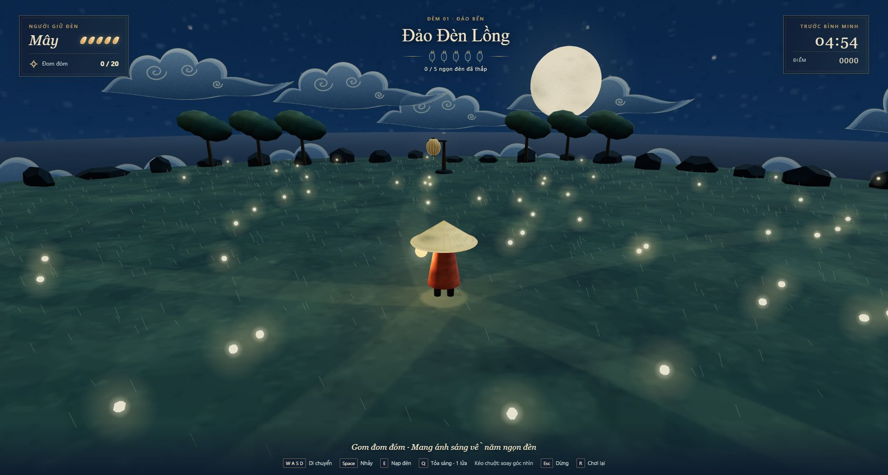

# Đảo Đèn Lồng — AI SDLC

**Video demo dưới 5 phút:** chưa ghi hình; cần thêm tại `docs/demo/demo.mp4` trước khi phát hành.

Game 3D góc nhìn thứ ba: Mây thu thập đom đóm, thắp và châm dầu cho đèn, giữ
đảo sáng qua ba đêm và né Bóng Mực. Trịnh Thanh Tùng · MSSV **2A202603456** ·
K5-L3A · Day 12.



## Chạy từ clone sạch — 3 lệnh

Yêu cầu: Node.js **20.19+ hoặc 22.12+**, npm, Chrome/Chromium (chỉ cần cho
benchmark) và trình duyệt hỗ trợ WebGL.

```sh
npm ci
node node_modules/vite/bin/vite.js build
npm run preview
```

Mở URL `http://127.0.0.1:4173` được in trong terminal. Preview chạy máy chủ
cục bộ cho web tĩnh và bảng xếp hạng. `npm run dev` chạy chế độ phát triển.
Không cần API key, tài khoản hay dịch vụ đám mây. Trên macOS/Linux, ba lệnh trên
giống nhau.

## Chơi và trợ năng

| Hành động | Mặc định |
|---|---|
| Di chuyển theo góc camera | W/A/S/D; mũi tên vẫn là bí danh mặc định |
| Xoay camera | Kéo chuột |
| Nhảy / lướt | Space / Shift |
| Tương tác với đèn gần | E |
| Tỏa sáng | Q |
| Tạm dừng / tiếp tục | Esc / P |

Menu **Cài đặt** cho phép đổi từng phím, phát hiện xung đột và khôi phục mặc
định; cài đặt được lưu trên thiết bị. Cũng có **Giảm chuyển động**, **Chữ lớn
(×1,25)** và **Bảng màu dễ phân biệt**. Mục tiêu trợ năng giữ cỡ chữ UI tối thiểu
18 px tại 1280×720. Bóng Mực, gió, 10 giây cuối và dầu yếu có thông báo hình ảnh
và vùng đọc màn hình; mũi tên ở cạnh màn hình chỉ hướng Bóng Mực gần nhất.

## Kiểm thử và lệnh hợp đồng

Contract đầy đủ: [game.contract.json](game.contract.json), phiên bản **1.3**.
Simulation dùng tick cố định 60 Hz; cùng core chạy trong trình duyệt và CLI.
Các lệnh trả mã 2 cho đối số sai, mã 1 cho lỗi runtime.

```sh
npm test
node src/headless.js --seed 12 --night 1 --ticks 600 --out result.jsonl
npm run verify:phase3
```

JSONL giữ định dạng v1.2. Có thể đặt scenario/input và snapshot interval:
`--scenario file.json --inputs file.json --snapshot-every 10`.

### Benchmark Contract 1.3

Cài Chrome/Chromium và chạy:

```sh
node scripts/bench.js --seed 42 --duration 30 --out docs/evidence/phase-4-final/bench.json
```

Lệnh mở cửa sổ Chrome riêng 1280×720 với cảnh Night 1, 200 Bóng Mực wander,
100 đom đóm, 3 đèn đầy dầu, rồi tự thoát sau 3 giây khởi động và đúng 30 giây
lấy mẫu. GPU VSync được yêu cầu tắt qua cờ Chrome; `requestAnimationFrame` vẫn
phụ thuộc lịch dựng hình của trình duyệt. `peak_mem_mb` đo RSS tiến trình Chrome
và các tiến trình con; nếu hệ điều hành không hỗ trợ bộ đếm sẽ là `null`.
Kết quả trên máy cá nhân chỉ để tham khảo. Máy chấm của giảng viên mới quyết
định ngưỡng 60 FPS trung bình, 30 FPS p1-low và tải ≤10 giây.

### Soak test Contract 1.3

```sh
node --jitless --expose-gc --max-old-space-size=16 --max-semi-space-size=1 scripts/soak.js --seed 7 --nights 10 --out docs/evidence/phase-4-final/soak.json
```

Chạy 10 đêm trong một tiến trình Node, luân phiên Đêm 1/2/3, khởi tạo seed
`7 + số_đêm` (đêm đầu dùng seed 8), điều khiển giả lập theo seed, rồi reset state.
V8 JIT được tắt và semi-space giới hạn để giảm nhiễu RSS của code cache/heap
khởi động trong phép đo; mô phỏng, xác suất input và seed không thay đổi. Kết quả
gồm crashes, won/lost, RSS đầu/cuối và thời lượng.

### Bảng xếp hạng

Sau khi thua hoặc thắng chiến dịch, có thể nhập tên 3–12 ký tự `[A-Za-z0-9_]`.
Top 10 lưu trên đĩa cục bộ và mở từ menu chính; cùng dữ liệu được xuất bằng:

```sh
node src/local-server.js --export-leaderboard leaderboard.json
```

Trên Windows dữ liệu ở `%APPDATA%/DaoDenLong/leaderboard.json`; macOS dùng
`~/Library/Application Support/DaoDenLong/leaderboard.json`; Linux dùng
`$XDG_DATA_HOME/dao-den-long/leaderboard.json` hoặc `~/.local/share/dao-den-long`.
`DAO_DEN_LONG_DATA_DIR` cho phép chọn thư mục khác.

## Phase 4 evidence và phát hành

- Soak JSON và log xác minh: [`docs/evidence/phase-4-final/`](docs/evidence/phase-4-final/); bench JSON đang chờ lần chạy từ browser/host có quyền loopback.
- Yêu cầu, ma trận kiểm tra và giả định: [`docs/phases/phase-4-spec.md`](docs/phases/phase-4-spec.md).
- Quyết định kho điểm và benchmark: [`ADR-0004`](docs/adr/0004-local-runtime-and-phase4-metrics.md).
- Gói chạy được: `release/dao-den-long-v1.0.0.tar.gz` (sau build và `node scripts/package-release.js`; gồm web tĩnh, máy chủ cục bộ, README, MIT và credits).
- Video `.mp4` phải được quay từ game thật và ngắn hơn 5 phút trước khi phát hành.
- Retro bốn phase: [`docs/retro.md`](docs/retro.md); asset và công cụ: [`CREDITS.md`](CREDITS.md); giấy phép: [`LICENSE`](LICENSE).

Tag `phase-4` và GitHub Release `v1.0.0` là bước phát hành remote riêng; repo
phải public để hoàn tất yêu cầu bàn giao.

## Lịch sử và harness

| Tài liệu | Nội dung |
|---|---|
| [CHANGELOG.md](CHANGELOG.md) | Breaking changes và tính năng của cả bốn phase |
| [AGENTS.md](AGENTS.md) | Harness AI và quy tắc làm việc |
| [SUBMISSION.md](SUBMISSION.md) / [RULES.md](RULES.md) | Quy định lab và submission |
| [GUIDE.md](GUIDE.md) / [CHECKPOINTS.md](CHECKPOINTS.md) | Quy trình SDLC và mốc nghiệm thu |
| [AI usage](docs/ai-usage.md) / [Retro](docs/retro.md) | Nhật ký AI và đánh giá |
