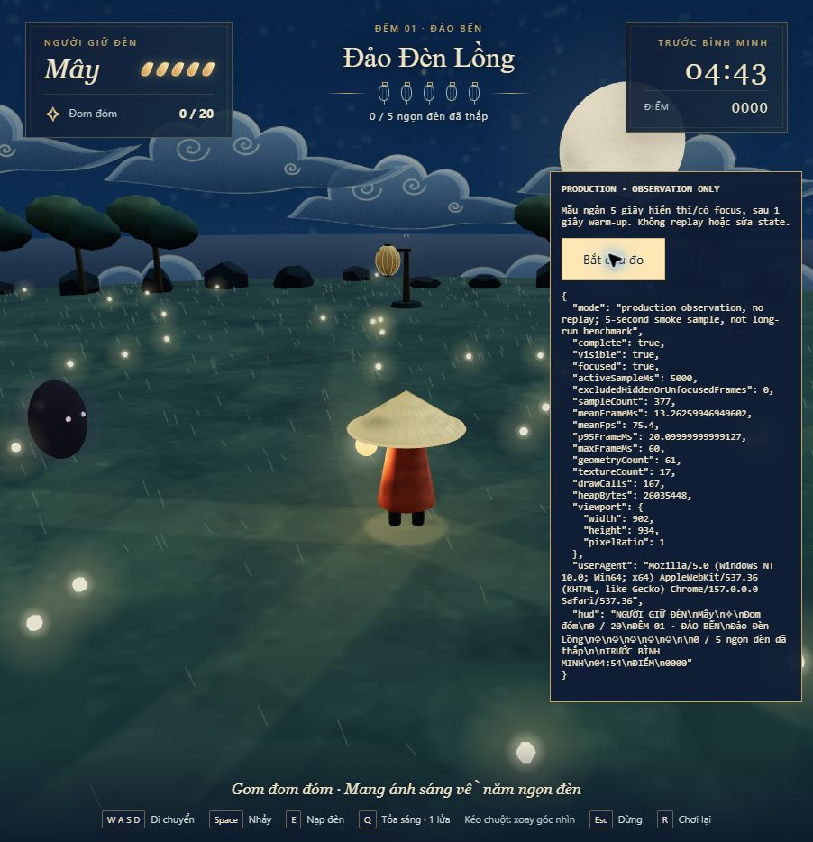
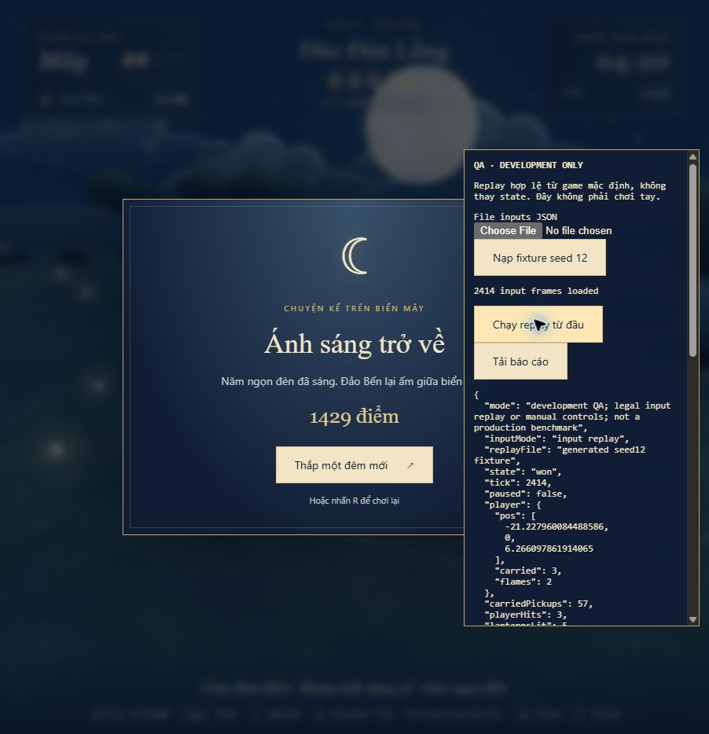

# Kiểm chứng bổ sung sau tag Phase 1

Tag đã công bố: `phase-1`, commit `a53d13ad186ce31936594ea2a8b25dea2a38c8d5`.
Các quan sát này được thu sau tag; không phải bằng chứng có sẵn tại thời điểm nộp.
Mã gameplay/tag được giữ nguyên. [Source identity](source-identity.json) xác nhận
HEAD/tag bằng nhau và không có sai khác source hash tại thời điểm kiểm tra.

## Chrome foreground

Người dùng cho phép khôi phục/focus cửa sổ Chrome riêng chứa game. Chỉ khôi phục
cửa sổ bình thường, không đổi cấu hình Chrome, GPU, bảo mật hoặc nguồn điện.
Production tại `127.0.0.1:4181/?metrics=1`; viewport 902×934, pixel ratio 1.

| Mẫu 5 giây sau warm-up | Frame | FPS trung bình | p95 frame time | max frame time |
|---|---:|---:|---:|---:|
| [Mẫu 1](chrome-foreground-1.json) | 420 | 83,84 | 20,1 ms | 50,1 ms |
| [Mẫu 2 sau restart](chrome-foreground-2.json) | 377 | 75,40 | 20,1 ms | 60,0 ms |
| [Mẫu 3, camera đã xoay](chrome-foreground-3.json) | 414 | 82,80 | 20,1 ms | 30,2 ms |

Cả ba báo visible/focused, không loại frame vì hidden/unfocused trong khoảng đo.
Đây là smoke samples ngắn, không phải 60fps tối thiểu hoặc benchmark ổn định dài
hạn. Mẫu cũ ~0,99 FPS trong trình duyệt tích hợp vẫn giữ ở báo cáo trước; điều kiện
khác nhau nên không sửa output cũ hay khẳng định nguyên nhân duy nhất đã được biết.



## Gameplay quan sát được

- W/Space/Escape: chạy nhặt 1 đom đóm, điểm tăng 10; pause giữ thời gian 04:59.
  [Ảnh input/pause](keyboard-pickup-pause.jpg).
- Kéo chuột khi pause xoay góc nhìn trong khi HUD/thời gian giữ nguyên:
  [ảnh camera](camera-rotated-pause.jpg).
- Nút tiếp tục hoạt động; Q giảm sinh lực từ 5 xuống 4. Console không có error/warn
  trong các lần quan sát. Không khẳng định tất cả nhánh lỗi đều được bao phủ.
- [Replay đầy đủ foreground](foreground-full-replay.json) gửi input hợp lệ từ game
  mặc định và thắng ở tick 2414: 57 pickup, 3 hit, 2 lửa, 5 đèn, 1429 điểm. Wall
  time ~40,26s; frame interval mean ~12,06ms, p95 ~20,1ms. Đây là development
  input replay, không phải lượt thắng bằng bàn phím hoàn toàn hoặc production FPS.



## Bản sao sạch Windows từ tag

Đã xuất tag bằng `git archive phase-1` vào thư mục tạm mới, không có `node_modules`
hoặc `dist`. Không gọi đây là clone từ remote. Các lệnh thực tế đã chạy thành công:

```text
npm ci --fetch-retries=0 --fetch-timeout=20000 --no-audit --no-fund
npm run build
npm test
node src/headless.js --seed 12 --night 1 --ticks 18000 --inputs docs/evidence/phase-1-final/full-playthrough-inputs.json --out <temporary-output>
```

`npm ci`: thêm 15 packages; test: 83/83 đạt. Build vẫn cảnh báo chunk JS >500kB.
Hai lần headless đều kết thúc `{"type":"end","ticks":2414,"state":"won","score":1429}`;
cùng SHA-256 `3CDA84AC7310A244FA7F3E919B8540AF5B8C5B6EC0E230E6DC7C7CB25E8DAC07`.
Kết quả này là quan sát được ghi lại, không phải raw CI log; không chứng minh Linux.

## Workflow Ubuntu — đã chạy thành công

File: [verify-phase-1.yml](../../../.github/workflows/verify-phase-1.yml).
Workflow được thêm bằng commit `9d646cb5943c849f347165e2b9daf7fc2ab6258c` và tự chạy
khi push. [Run 44718587705](https://github.com/TgTrh06/K5-L3A-DAY12-TrinhThanhTung-2A202603456-AI-SDLC-Dao-Den-Long/actions/runs/44718587705)
kết thúc success lúc 17:22 ngày 20/11/2026 (ICT). Bước identity trong artifact xác
nhận `tested_commit=a53d13ad186ce31936594ea2a8b25dea2a38c8d5`, khác workflow commit
như thiết kế. Tag không được di chuyển. WSL local vẫn lỗi nhưng CI cung cấp Linux
host độc lập; không có sửa cấu hình WSL.

Đã tải artifact `phase-1-ubuntu-44718587705-1` (ID `14620527575`) và đối chiếu digest
ZIP với API: `9620ee97d9627d62b96ede452145919f2602464f3f09f2c809cea1f4863cc9d4`.
Đã đọc identity, runtime, cài đặt, test/build, HTTP và JSONL trong artifact:

- Ubuntu 24.04.5 LTS x64, Node v22.23.4, npm 10.9.9.
- `npm ci`: thành công, thêm 15 packages; npm audit báo 0 vulnerabilities tại lần chạy.
- Test: 83 pass, 0 fail; build thành công, vẫn có cảnh báo chunk JS >500kB.
- Headless: won, tick 2414, 1429 điểm, 5 đèn, 57 pickup, 3 hit, 2 lửa còn lại.
- Hai JSONL cùng SHA-256
  `3CDA84AC7310A244FA7F3E919B8540AF5B8C5B6EC0E230E6DC7C7CB25E8DAC07`,
  cũng khớp lần clean-run Windows; controller events/end bằng CLI.
- Production HTML/JS/CSS trả HTTP 200; mọi bước bắt buộc và upload artifact success.

Artifact lưu trên GitHub, hết hạn dự kiến 20/12/2026; tải từ trang run khi cần giữ lâu.
Raw `run-summary.json` của script trong tag có một câu note cố định nói không đưa
ra Linux claim. Đó là text cũ trong tag, không phải kết quả phát hiện OS: cùng file
ghi `platform=linux`, identity ghi Ubuntu và các exit code đều 0. Giữ nguyên raw
output; kết luận Linux ở đây dựa trên identity/runtime và log thực tế, không sửa tag
hoặc sửa tay output để thay câu note đó.

Để chạy lại và đọc bằng chứng:

1. Vào Actions → **Verify Phase 1 on Ubuntu** → Run workflow → chọn `main`.
2. Kiểm tra bước identity: `tested_commit` đúng SHA tag phía trên. `workflow_commit`
   khác SHA này là bình thường: YAML ở commit bổ sung, game được checkout từ tag.
3. Đọc kết quả từng bước cài sạch, verification, HTTP. Bất kỳ bước bắt buộc đỏ thì
   chưa đạt. Artifact được upload dù lỗi để hỗ trợ chẩn đoán; có artifact không có
   nghĩa toàn job xanh.
4. Tải artifact và đối chiếu `identity.txt`, `runtime.txt`, `install.txt`,
   `verification.txt`, `http.txt`, cùng log/JSONL/hash mới từ script kiểm chứng.
5. Lưu link run và đánh giá riêng. Không di chuyển tag hoặc sửa thời điểm nộp.

Runner Ubuntu 24.04, Node 22; timeout 15 phút; chỉ quyền đọc contents. Các action
được cố định SHA; checkout không lưu credential trong repo. Output sinh mới trong
runner, không commit ngược. Artifact lưu 30 ngày; tải về nếu cần lưu lâu hơn.
Không yêu cầu user secret và không có deploy/release.

Workflow chuyển bộ evidence lịch sử có sẵn trong tag ra ngoài đường dẫn upload
trước khi chạy. Vì vậy log Windows cũ không bị đưa vào artifact như kết quả Linux
nếu `npm ci` hoặc test thất bại. Không có bước `continue-on-error` cho các kiểm tra.

Kiểm tra local khi chuẩn bị workflow: YAML được parse và đối chiếu trigger,
permissions, commit guard và SHA action; 7 khối Bash qua kiểm tra cú pháp bằng
Git Bash; đoạn Node HTTP qua `node --check`. HTTP smoke trên production preview
Windows trả 200 cho HTML/JS/CSS và fail khi preview chưa chạy. Link Markdown trong
hai README mới/cập nhật đều tồn tại, `git diff --check` đạt. Đây là kiểm tra local,
không phải chạy đầy đủ GitHub runner hoặc kiểm tra bằng actionlint.

Linux CI này chỉ chứng minh cài/test/build/headless và HTTP được chạy trên Ubuntu.
Đồ họa WebGL, lượt chơi tay đầy đủ và ổn định dài hạn vẫn cần đánh giá riêng.
License và các yêu cầu phase sau vẫn chưa hoàn tất. Không đánh đồng tag đã nộp
với tất cả tiêu chí nghiệm thu đã đạt.
